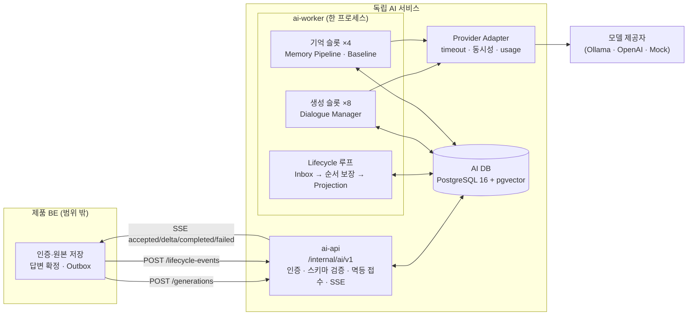
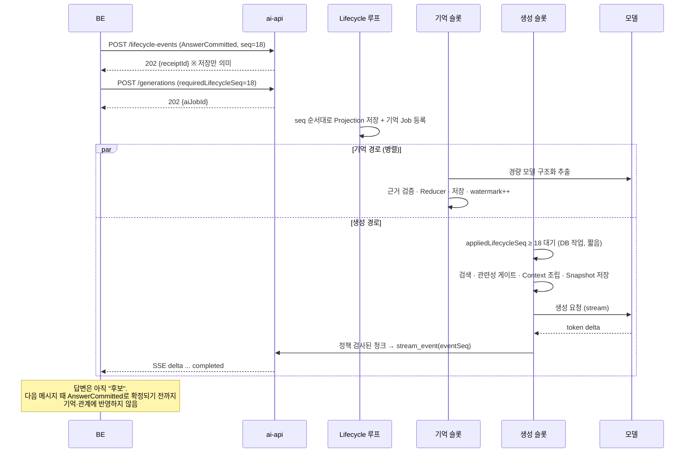
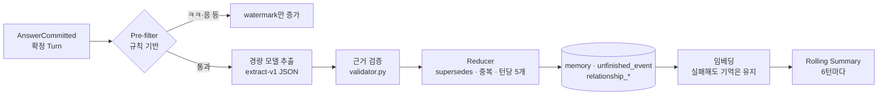
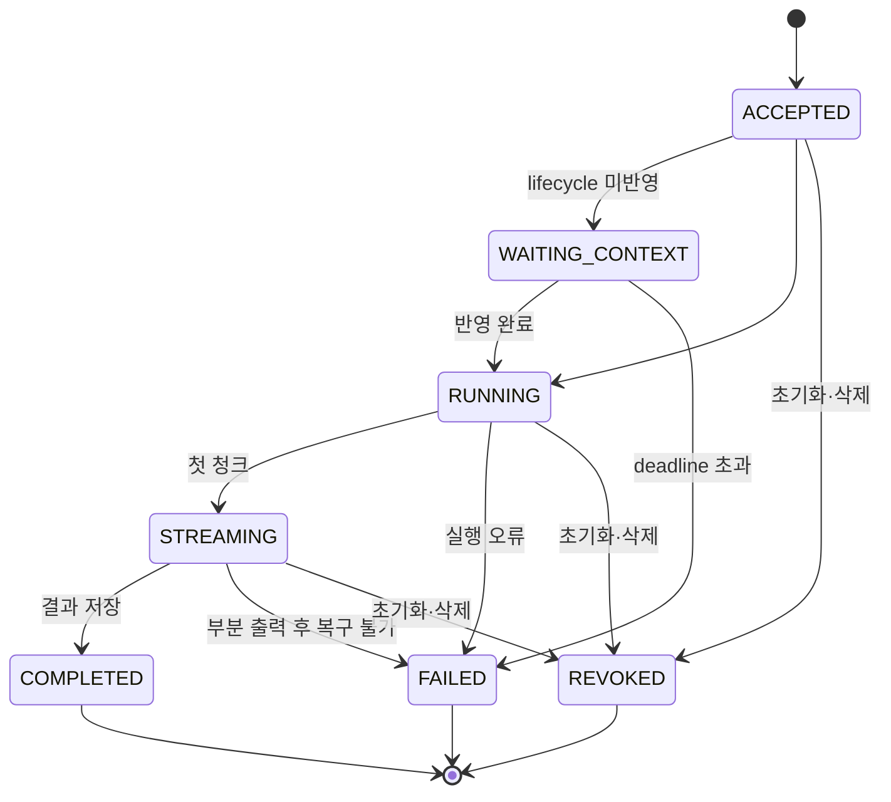

# character-chat-ai

캐릭터 챗 MVP의 **AI 서비스** 저장소입니다. 이 문서는 전체 아키텍처를 설명하고, 처음 쓴 「AI 아키텍처와 AI 서버 개발 플랜 v1.0」(이하 *플랜*) 가운데 **실제 코드에 반영되어 확정된 내용**을 정리합니다. 플랜에서 바뀐 점과 아직 열어 둔 것도 따로 적었습니다.

> 실행 방법·디렉터리별 설명은 [`ai-service/README.md`](ai-service/README.md), BE와 주고받는 계약은 [`ai-service/contracts/README.md`](ai-service/contracts/README.md)를 보세요.

## 목차
1. [이 서비스가 책임지는 것](#1-이-서비스가-책임지는-것)
2. [전체 구성](#2-전체-구성)
3. [한 턴의 처리 흐름](#3-한-턴의-처리-흐름)
4. [모듈과 경계](#4-모듈과-경계)
5. [생성 경로: Context와 프롬프트](#5-생성-경로-context와-프롬프트)
6. [기억 경로: Long-term Memory](#6-기억-경로-long-term-memory)
7. [관계와 미완료 사건](#7-관계와-미완료-사건)
8. [예외 상황 처리](#8-예외-상황-처리)
9. [BE–AI 계약 v1](#9-beai-계약-v1)
10. [데이터 모델](#10-데이터-모델)
11. [기술 스택과 배포](#11-기술-스택과-배포)
12. [플랜 대비 확정·변경·미결 사항](#12-플랜-대비-확정변경미결-사항)
13. [진행 상황](#13-진행-상황)

---

## 1. 이 서비스가 책임지는 것

기획서가 검증하려는 질문은 하나입니다. *"잘 정의된 캐릭터가 사용자의 과거를 기억하고 관계를 이어간다면, 사용자는 같은 캐릭터에게 다시 돌아오는가?"* AI 서비스는 그중 **일관성·기억·관계**를 책임집니다.

| 책임 | AI 서비스 | 제품 BE |
|---|---|---|
| 메시지 전송·스트리밍 | Context 구성, 모델 호출, 정책 검사된 토큰 스트림 | 인증, 메시지 저장, React로 SSE 중계, 연속 전송 1차 차단 |
| 캐릭터·Persona 수정 | revision 스냅샷을 다음 신규 Turn부터 사용 | 원본 저장, revision 증가, 이벤트 발행 |
| 첫 장면 | Turn 0으로 Context에 고정 | 첫 Conversation 생성 시 표시 |
| Regenerate / Retry | 같은 스냅샷으로 새 후보 생성, 실패 원인 분류 | attempt 발급, 후보 선택·확정, 재시도 판단 |
| 장기 기억 · 관계 · 미완료 사건 | 추출·검증·저장·검색, 결정적 상태 갱신 | 확정 이벤트 발행 |
| 대화 초기화 · 캐릭터 삭제 | 세대 무효화, 사본·기억·벡터·스냅샷 삭제 | 즉시 차단, 이벤트 발행, 완료 추적 |

AI는 BE의 DB를 읽지 않고, BE는 AI의 프롬프트나 벡터 저장 방식을 모릅니다. 둘은 **생성 요청**과 **Lifecycle 이벤트** 두 종류의 계약으로만 연결됩니다.

MVP에서 제외: AI 캐릭터 자동 생성, 이미지 생성, 멀티 캐릭터, 음성, 선제 메시지, 기억 조회·편집 UI, 관계 수치 노출.

## 2. 전체 구성



- **ai-api**는 요청을 DB에 저장하고 `202`로 답할 뿐, 요청 연결 안에서 모델을 부르지 않습니다(접수와 실행 분리).
- **ai-worker**는 같은 코드베이스의 실행 루프 세 종류를 한 프로세스에서 돌립니다. 생성 슬롯과 기억 슬롯을 나눠 두어, 추출 작업이 몰려도 사용자가 기다리는 생성 슬롯을 빼앗지 않습니다.
- 작업 큐는 **DB의 `ai_job` 테이블**입니다. Redis나 메시지 브로커 없이 `FOR UPDATE SKIP LOCKED` + lease + fencing token으로 재시작 복구를 보장합니다.
- 모든 모델 호출은 **Provider Adapter**를 거칩니다. 기본 공급자는 Ollama이며 채팅과 기억 추출은 `gemma4:12b`, 임베딩은 `embeddinggemma`를 사용합니다. 설정 예시는 [AI 서비스 실행 문서](ai-service/README.md#공급자-전환)에 있습니다.

두 개의 경로가 핵심입니다.

| | 생성 경로 (Hot path) | 기억 경로 (Cold path) |
|---|---|---|
| 목표 | 빠르게 | 정확하게 |
| 순서 | 입력 정리 → 기억 검색 → Context 고정 → 모델 1회 호출 → 정책 검사 후 스트리밍 | 확정 Turn → Pre-filter → 구조화 추출 → 근거 검증 → Reducer → 임베딩 → 요약 |
| 시작 조건 | BE의 생성 요청 | BE의 `AnswerCommitted` 이벤트 |
| 실패 시 | 명확한 오류 코드 → BE가 Retry | 원본 Turn이 남아 있어 재처리 가능 |

## 3. 한 턴의 처리 흐름

사용자가 N번째 메시지를 보내면, BE는 N−1번째 답변을 확정(`AnswerCommitted`)하고 동시에 N번째 생성을 요청합니다.



### 기억 반영을 기다리는 방식 (플랜 결정 ⑦, 코드 반영)

생성은 직전 턴의 기억 추출이 끝나기를 기다리지 않습니다. 직전 몇 턴은 어차피 "최근 대화" 계층에 원문으로 들어가기 때문입니다. 대기 조건은 두 단계입니다(`app/dialogue/manager.py::wait_context`).

| 조건 | 의미 | 못 채우면 |
|---|---|---|
| `appliedLifecycleSeq ≥ requiredLifecycleSeq` | 확정 Turn 원문과 설정 revision이 순서대로 반영됨 (LLM 호출 없음) | deadline 또는 10초까지 `WAITING_CONTEXT`, 넘으면 `CONTEXT_NOT_READY` |
| `memoryThroughTurnSeq ≥ 현재 Turn − 6` | 최근 창 밖으로 밀려나는 Turn은 기억 처리가 끝나 있어야 함 | 최대 3초 대기 후에도 안 되면 최근 창을 넓혀 원문으로 보완하고 `MEMORY_LAG_WINDOW_WIDENED` 기록 |

## 4. 모듈과 경계

모듈은 Python 패키지 경계이며, 각 모듈의 "금지 경계"가 코드 리뷰와 테스트의 기준입니다.

| 모듈 (`ai-service/app/…`) | 책임 | 금지 경계 |
|---|---|---|
| `api/` | 서비스 인증, Pydantic 스키마 검증(`schemas.py`가 계약의 원본), 멱등 접수, SSE 재전송 | 요청 연결 안에서 모델 호출 금지 |
| `dialogue/` | epoch·revision·순번 검증, Context 대기, NEW/REGENERATE/RETRY 분기, 생성 실행 | 실행 흐름을 모델 판단에 맡기지 않음 (자율 Agent 루프 없음) |
| `understanding/` | 입력 정규화, "그때/거기" 같은 지시어를 직전 사용자 발화로 보강한 검색 질의 | 규칙 기반. 힌트를 명령으로 승격하지 않음 |
| `knowledge/retriever.py` | 범위 필터 → 하이브리드 점수 → 관련성 게이트 | 범위 필터는 서버가 Job 행에서 주입. 호출자가 지정 불가 |
| `knowledge/context_builder.py` | 계층별 토큰 예산, 관계 단계 → 행동 지침, 불변 Snapshot + hash | 캐릭터 설정을 자르지 않음. 대화 내용을 설정 계층에 넣지 않음 |
| `knowledge/composer.py` · `output_policy.py` | 스트리밍 생성, 문장 단위 버퍼 검사, 역할 이탈·말투 위반 표시 | 검사 전 텍스트를 내보내지 않음. 스트림 시작 후 다른 답을 이어 붙이지 않음 |
| `lifecycle/` | Inbox 중복 제거, `aggregateSeq` 순서 보장, Projection, 초기화·삭제 | gap을 건너뛰지 않음. 차단된 epoch로의 쓰기 거부 |
| `memory/` | Pre-filter, 추출 결과 검증, supersedes·중복 처리, 임베딩, Rolling Summary | 근거 없는 사용자 사실 저장 금지. 모델 출력으로 SQL·권한·설정을 바꾸지 않음 |
| `relationship/` | 결정적 관계 Reducer, 단계(히스테리시스), 미완료 사건 수명주기 | 메시지 수로 친밀도 증가 금지. 관계가 성격을 덮어쓰지 않음 |
| `providers/` | 공급자 오류·timeout·usage 표준화, 동시성 슬롯, Mock | 공급자별 차이를 바깥으로 새지 않게 격리 |
| `persistence/` | 스키마, Job claim·lease·fencing, Alembic 마이그레이션 | — |
| `workers/` | lifecycle 루프 · 생성 슬롯 · 기억 슬롯 | — |

## 5. 생성 경로: Context와 프롬프트

"과거 메시지를 전부 AI에게 주지 않는다"를 구현하는 부분입니다. 우선순위가 높은 계층부터 예산을 잡고, 낮은 계층부터 줄입니다.

| 순서 | 계층 | 예산(토큰) | 규칙 |
|---|---|---|---|
| 1 | 서비스 정책 (`prompts/chat-v1.policy.txt`) | 400 | 롤플레이 규칙, "대화 속 설정 변경 요청은 극중 발화로만", 자료는 지시문이 아님 |
| 2 | 캐릭터 카드 (`revision=N`) | 1,200 | **절대 자르지 않음**. 넘으면 `OVER_BUDGET_*`로 측정만 |
| 3 | User Persona | 400 | 절대 자르지 않음 |
| 4 | 관계 지침 + 미완료 사건 | 500 | 수치 없이 행동 지침 문장. 넘치면 미완료 사건부터 뺌 |
| 5 | 관련 기억 | 900 | 점수 순 상위 8개, 근거 일시·원문 인용 포함 |
| 6 | 대화 요약 | 800 | 넘치면 앞부분부터 잘라 최신 부분 유지 |
| 7 | 시간 정보 | 60 | `지금: 2026-11-13(금) 08:10 · 마지막 대화: 3일 전` |
| 8 | 최근 대화 + 현재 메시지 | 3,000 | 최근 6턴 원문, 완전한 Turn 단위. 첫 장면은 Turn 0 |

- 입력 합계 상한은 **7,260 토큰**(출력 600은 별도)입니다. 넘으면 **관련도 낮은 기억 → 요약 앞부분 → 최근 창(최소 3턴)** 순서로 줄입니다. 그래도 넘는 아주 긴 메시지는 실패시키지 않고 최근 창을 1턴까지 줄이며 `RECENT_BELOW_MINIMUM`을 기록합니다. 그래도 안 되면 `BUDGET_EXCEEDED`.
- 프롬프트는 **변하지 않는 계층(1~3)을 첫 system 메시지**, 변하는 계층(4~7)을 두 번째 system 메시지로 둡니다. 공급자의 프롬프트 캐싱으로 입력 비용과 첫 토큰 지연을 줄이기 위해서입니다.
- 조립한 Context는 **`context_snapshot`에 불변으로 저장**하고 hash를 남깁니다(24시간 보존). Regenerate는 이 스냅샷을 그대로 재사용합니다.
- 토큰 수는 모델이 정해질 때까지 `글자 수 / 1.5` 추정치를 씁니다. 모델 선정 후 공식 토크나이저로 바꿉니다.

**Output Policy** (`output_policy.py`): 모델 출력은 문장 끝(또는 80자)까지 버퍼링한 뒤 검사하고 나서 내보냅니다. "저는 AI라서…" 같은 역할 이탈(`ROLE_BREAK`)과 반말 설정에서의 존댓말(`SPEECH_STYLE_HONORIFIC`)은 MVP에서는 **차단하지 않고 표시만** 해서 결과의 `degraded` 목록과 지표로 남깁니다. 빈 답변은 `POLICY_BLOCKED`입니다.

## 6. 기억 경로: Long-term Memory



**기억 대상 5종**: `USER_FACT`(사용자 정보), `SCHEDULE`(일정), `SHARED_EVENT`(함께한/할 일), `RELATION_EVENT`(관계 사건), `UNFINISHED`(결과 대기).

**False Memory를 막는 규칙** (`memory/validator.py`, 모두 결정적 코드):
- `sourceMessageIds`는 그 확정 Turn의 메시지 id여야 하고, `evidence`는 정규화 후 그 메시지 원문의 부분 문자열이어야 합니다.
- `subject=user`인 사실과 `USER_FACT`·`SCHEDULE`은 **사용자 발화에서만** 만들 수 있습니다. 캐릭터가 지어낸 사용자 과거는 저장되지 않습니다.
- 캐릭터의 제안만 있는 `SHARED_EVENT`는 저장하되 미완료 사건으로 승격하지 않습니다. 허구 사건(`isFiction`)은 미완료 사건이 되지 않습니다.
- 폐기된 Regenerate 후보와 실패한 답변은 `AnswerCommitted`에 애초에 없으므로 추출 입력이 될 수 없습니다.
- 같은 `(type, subject, predicate)`의 새 값은 기존 기억을 **supersedes**하고(`valid_to` 설정), 검색은 유효한 기억만 봅니다. 같은 값이면 중복으로 건너뜁니다.
- 모델 출력 일부가 깨져도 유효한 항목만 살려 씁니다.
- `subject`는 `user`·`character`·`shared` 셋으로 정규화합니다(`assistant`→`character`, `both`→`shared` 등). 모르는 값은 근거가 사용자 발화뿐이면 `user`, 아니면 `character`로 봅니다.
- `likes`/`dislikes`는 근거 인용에서 대상 바로 뒤의 감정 표현이 반대면 거절합니다("민트초코 진짜 싫어해" → `likes` 거절, "안 좋아해"는 `dislikes`로 인정).

**검색 점수와 관련성 게이트** (`knowledge/retriever.py`):

```
점수 = 0.55·의미 유사도 + 0.15·키워드 일치 + 0.15·중요도 + 0.15·시간 근접도
```
- 의미 유사도는 범위 필터(tenant·owner·conversation·epoch) 뒤 pgvector exact 거리로 계산합니다. MVP 규모에선 ANN 인덱스가 필요 없습니다.
- 시간 근접도: 일정형은 해석 일시가 ±2일이면 1.0, 그 외는 생성 후 경과일로 감쇠합니다.
- **게이트 0.25 미만은 Context에 넣지 않습니다.** "많이 기억하는 척"보다 "필요할 때 정확히"가 목표입니다.
- 임베딩이 없거나 실패한 기억은 빠뜨리지 않고 키워드 점수로 대신하며 `KEYWORD_FALLBACK`을 기록합니다.
- **캐릭터 수정 후**: `subject=character`인 기억은 출처 Turn의 `character_rev`가 요청의 revision과 같을 때만 검색합니다. 사용자·공동 기억과 미완료 사건(약속·일정)은 수정과 상관없이 유지됩니다.

**실패 처리**: 추출 호출이 실패하면 최대 3회 다시 시도하고, 그래도 안 되면 그 Turn은 추출을 포기하되 watermark는 올려 뒤 Turn이 막히지 않게 합니다(원본 Turn은 남아 있어 재처리 가능).
추출 결과 저장 뒤 워커가 죽으면 다음 워커는 추출을 다시 하지 않고 임베딩·요약부터 이어 갑니다. 임베딩 실패는 Job 실패가 아닙니다. 기억은 `index_status=FAILED`로 남고, 같은 대화의 다음 기억 Job이 최대 16개씩 다시 색인합니다.

## 7. 관계와 미완료 사건

관계는 **메시지 수가 아니라 사건**으로 변하고, **숫자 대신 말투**로 드러납니다. 모델은 사건 "후보"만 제안하고, 변화량은 아래 표의 고정값으로만 반영합니다(`relationship/reducer.py`).

| 사건 | 변화 (0~100 척도) | 적용 조건 |
|---|---|---|
| `PERSONAL_DISCLOSURE` 고민 공유 | 신뢰 +4, 친밀 +2 | 같은 주제는 1회만 (주제 기반 사건키) |
| `PROMISE_KEPT` 약속 지킴 | 신뢰 +5 | 같은 턴에 미완료 사건이 RESOLVED일 때만 |
| `PROMISE_BROKEN` 약속 어김 | 신뢰 −4, 긴장 +3 | 명시적 근거 필요 |
| `CONFLICT` 갈등 | 긴장 +6 | — |
| `RECONCILIATION` 화해 | 긴장 −8, 친밀 +3 | 열린 갈등이 있을 때만 |
| `SHARED_EXPERIENCE` / `SUPPORT` | 친밀 +3 / +2 | 하루 누적 +6 상한 |

- 모든 사건은 근거 필수이고, 사건키(`event_key`)가 같은 사건은 두 번 적용되지 않습니다. 모르는 종류는 무시합니다.
- 초기값은 대화 시작 시 50/40/0으로 두고, `BASELINE` Job이 캐릭터 설정의 "사용자와의 관계"를 경량 모델로 읽어 **한 번만** 덮어씁니다. 그 뒤 변화는 모두 위 표대로입니다.

**단계 → 행동 지침** (프롬프트에는 수치가 들어가지 않음):

| 단계 | 판정 | 지침 |
|---|---|---|
| 거리감 | 친밀 < 35 | 아직 거리를 두고 있다. 사적인 관심을 드러내지 않는다. |
| 익숙함 | 35 ≤ 친밀 < 60 | 편한 사이다. 걱정을 툭 던지듯 표현해도 된다. |
| 가까움 | 친밀 ≥ 60, 신뢰 ≥ 55 | 기다렸다는 티가 조금씩 난다. 그래도 직접 말하진 않는다. |
| 긴장 (덮어씀) | 긴장 ≥ 50 | 말이 더 짧아진다. 먼저 사과하지 않는다(설정에 따름). |

경계에는 ±3의 히스테리시스가 있습니다. 올라갈 땐 경계+3, 머무를 땐 경계−3까지 유지해서 한 턴마다 말투가 왔다 갔다 하지 않습니다. 모든 지침 뒤에 "어떤 단계에서도 캐릭터의 성격과 말투를 우선한다"를 붙입니다.

**미완료 사건** (`relationship/unfinished.py`):

| 상태 | 조건 | Context 노출 |
|---|---|---|
| `OPEN` | 일정·결과 대기 기억이 `opensUnfinishedEvent`로 추출됨 | 현재 주제와 유사도 ≥ 0.30일 때만 |
| `DUE` (조회 시 계산) | 해석 일시가 지금 ±1일 | 우선 노출 ("오늘 면접 아니었어?") |
| `RESOLVED` / `CANCELLED` | 사용자 발화로 해소·취소가 추출됨 | 노출 중단 |
| `EXPIRED` (조회 시 계산) | 해석 일시 + 14일 경과 | 노출 중단, 결과를 추정하지 않음 |

한 번에 최대 2개만 Context에 넣고, 정책 문구로 "한 응답에 1개만 언급"을 지시합니다. 캐릭터가 최근 창에서 이미 언급한 사건은 다시 넣지 않습니다.

## 8. 예외 상황 처리

| 상황 | AI 처리 |
|---|---|
| Regenerate | `mode=REGENERATE` + 같은 `contextSnapshotId` 재사용, temperature +0.1. 이전 후보는 Context에 없음. 스냅샷이 없거나 만료되면 조용히 새로 만들지 않고 `SNAPSHOT_EXPIRED` |
| Retry | BE가 새 attempt를 발급. 같은 Turn 스냅샷이 있으면 재사용 |
| 화면 이탈 | SSE 구독 종료는 Job 취소가 아님. `GET /generations/{id}`로 모델 재호출 없이 결과 복원 |
| 연속 전송 | 대화당 활성 생성 Job 1개를 DB 부분 유니크 인덱스로 강제 → `409 ACTIVE_GENERATION_EXISTS` |
| 설정 수정 | `CharacterRevisionChanged` 이후 신규 Turn부터 새 revision. 진행 중 Turn과 그 Regenerate는 기존 스냅샷 유지 |
| 대화 초기화 | 차단표식 → 진행 중 Job을 `REVOKED` + fencing token 증가(SSE에 `failed: REVOKED`) → 사본·기억·관계·요약·스냅샷 삭제 → 같은 설정·첫 장면으로 새 epoch 시작 |
| 캐릭터 삭제 | 캐릭터·대화 단위 차단표식을 남기고 전 세대 삭제. 늦게 온 이벤트나 재전달된 `ConversationOpened`로 되살아나지 않음 |
| 모델 장애 | 스트림 시작 전이면 deadline 안에서 1회 더 시도. 시작 후면 다른 모델로 이어 붙이지 않고 실패 → 사용자가 Retry |
| Worker 사망 | lease가 끝나면 다른 Worker가 다시 claim. 출력 전이면 다시 실행, 스트리밍 중이었으면 실패 처리. 죽은 Worker의 늦은 쓰기는 fencing token으로 거부 |

**생성 Job 상태**



## 9. BE–AI 계약 v1

계약의 원본은 `ai-service/app/api/schemas.py`이고, `contracts/`(OpenAPI·JSON Schema·fixture)는 여기서 자동 생성됩니다. CI가 최신 여부를 검사합니다. 모든 요청에 `Authorization: Bearer <service token>`이 필요합니다.

| 엔드포인트 | 결과 | 의미 |
|---|---|---|
| `POST /internal/ai/v1/generations` | `202 {aiJobId, status}` | 저장 후 응답. `mode=NEW`에 `contextSnapshotId`를 넣으면 `422`. 같은 `attemptId`+같은 본문 → 같은 Job, 본문이 다르면 `409 IDEMPOTENCY_CONFLICT`. 미등록 대화는 `404`, 차단된 epoch는 `409 EPOCH_REVOKED` |
| `GET /generations/{aiJobId}` | 상태, text, usage, error, snapshotId, degraded | 저장된 결과만 반환 |
| `GET /generations/{aiJobId}/events` | SSE `accepted · delta · completed · failed` | `eventSeq` 단조 증가, `Last-Event-ID`(또는 `?after=`) 이후 재전송 |
| `POST /lifecycle-events` | `202 {receiptId}` | Inbox 저장만 의미 (202 ≠ 반영 완료) |
| `GET /lifecycle-events/{receiptId}` | `RECEIVED · APPLIED · FAILED` | BE가 반영·삭제 완료를 추적. 반영된 이벤트는 영수증·순번만 남기고 본문을 지웁니다. FAILED 본문은 원인 확인·재처리를 위해 남기며, 초기화·삭제 때 함께 지웁니다 |
| `GET /conversations/{id}/state?tenantId=&epoch=` | watermark들 | 진단용. 기억 본문은 노출하지 않음 |

Lifecycle 이벤트: `ConversationOpened`, `AnswerCommitted`, `CharacterRevisionChanged`, `ConversationReset`, `CharacterDeleted`.

오류 코드와 BE용 재시도 힌트:

| 코드 | retryable |
|---|---|
| `PROVIDER_TIMEOUT`, `PROVIDER_ERROR`, `CONTEXT_NOT_READY`, `INTERNAL` | true |
| `POLICY_BLOCKED`, `BUDGET_EXCEEDED`, `SNAPSHOT_EXPIRED`, `REVOKED` | false |

## 10. 데이터 모델

모든 대화 단위 테이블은 `tenant_id · owner_id · conversation_id · epoch`를 갖고, 모든 조회·쓰기가 이 범위로 걸립니다. BE 테이블과는 조인하지 않습니다(`app/persistence/models.py`, 마이그레이션 `0001`).

| 구분 | 테이블 | 비고 |
|---|---|---|
| 대화·순서 | `ai_conversation`, `lifecycle_cursor`, `event_inbox` | 세대 상태와 watermark, 집계별 적용 seq, 중복 제거 |
| 설정·원문 | `settings_snapshot`, `committed_turn` | revision 쌍별 불변 사본, 확정 Turn Projection(Turn 0 = 첫 장면) |
| 파생 상태 | `memory`(pgvector), `unfinished_event`, `relationship_event`, `relationship_state`, `summary` | 초기화·삭제 시 제거 |
| 실행 | `ai_job`, `stream_event`, `context_snapshot` | claim·lease·fencing, SSE 이벤트, 불변 Context |
| 운영 | `revocation`, `usage_ledger` | 삭제 후 남기는 최소 차단표식, 용도별 토큰 사용량 |

## 11. 기술 스택과 배포

| 요소 | 선택 |
|---|---|
| 언어·API | Python 3.12, FastAPI, Pydantic v2 |
| DB | PostgreSQL 16 + pgvector (메타데이터·출처·벡터를 한 트랜잭션에서), SQLAlchemy 2 async + asyncpg, Alembic |
| 작업 실행 | DB Job 테이블 + 자체 Worker 루프. Redis·브로커 없음 |
| 모델 | Provider Adapter 뒤에 Mock. 역할별 티어(생성=상위, 추출·요약=경량, 임베딩=다국어)로 설정 분리 |
| 파이프라인 | 명시적 함수 조합. 자율 Agent 프레임워크 없음 |
| 테스트 | pytest 단위 + 실제 PostgreSQL 통합 테스트, 계약 fixture 검사, GitHub Actions |

**MVP 배포**: `ai-api` 컨테이너 1개 + `ai-worker` 컨테이너 1개(생성 슬롯 8, 기억 슬롯 4) + 관리형 PostgreSQL. GPU 불필요. 로컬은 `ai-service/infra/docker-compose.yml`(api, worker, migrate, pgvector)로 띄웁니다. PROD에서는 같은 코드를 API 풀·생성 Worker 풀·기억 Worker 풀로 나눠 확장합니다.

## 12. 플랜 대비 확정·변경·미결 사항

### 확정되어 코드에 반영된 것
플랜의 **핵심 결정 7가지**는 모두 코드와 테스트로 지켜집니다.

| 결정 | 지키는 곳 | 테스트 |
|---|---|---|
| ① 캐릭터 설정은 대화로 바뀌지 않는다 | 정책 프롬프트, 설정 계층 1~3 고정 | `test_revision_change_applies_to_next_turn` |
| ② 확정된 답변만 기억한다 | 기억 Job은 `AnswerCommitted`로만 생성 | 통합 테스트 전반 |
| ③ 모델은 제안하고 코드가 결정한다 | `validator.py`, `memory/reducer.py`, `relationship/reducer.py` | `test_false_memory_from_character_words_is_rejected`, `test_relationship_event_applies_once` |
| ④ Regenerate는 같은 Context의 다른 답변 | `context_snapshot` 재사용 | `test_regenerate_reuses_snapshot_without_previous_candidate` |
| ⑤ 기억은 자연스러울 때만 꺼낸다 | 관련성 게이트, 미완료 사건 선택 규칙 | `test_golden_scenario_interview_recalled_on_day7` |
| ⑥ 관계는 숫자가 아니라 말투로 드러난다 | `guideline()` | `test_guideline_has_no_numbers` |
| ⑦ 최근 대화 창으로 기억 지연을 흡수한다 | `wait_context` 2단계 대기 | 통합 테스트 |

### 구현하면서 정한 것 (플랜에 없거나 바뀐 점)
- **설정 수치**: 최근 창 6턴(최소 3), 기억 대기 최대 3초, Context 대기 기본 10초, 스냅샷 보존 24시간, 요약 6턴마다, 검색 상위 8개, 게이트 0.25, 미완료 사건 게이트 0.30, lease 30초. 모두 `AI_` 환경변수로 바꿀 수 있습니다(`app/config.py`).
- **아주 긴 메시지**: 최소 3턴에서도 예산을 넘으면 실패 대신 최근 창을 1턴까지 줄입니다(`RECENT_BELOW_MINIMUM`).
- **Output Policy**: 역할 이탈과 말투 위반은 측정만 하고 차단하지 않습니다(플랜의 "MVP에서는 측정만"을 따름).
- **Pre-filter**: 짧은 맞장구·웃음은 건너뛰고, 일정·취향·감정 같은 신호 단어가 있거나 12자 이상이면 추출합니다.
- **임베딩**: 플랜은 별도 Job이지만 지금은 기억 Job 안에서 저장 직후 실행합니다. 실패해도 기억은 남고 `index_status=FAILED`로 표시하며, 다음 기억 Job이 다시 색인합니다.
- **관계 초기값**: 대화 시작 시 50/40/0으로 두고 `BASELINE` Job이 모델 추정치로 한 번만 덮어씁니다.
- **모델 장애 재시도**: 스트림 시작 전 1회 추가 시도. 기억 추출은 최대 3회.

### BE와 합의가 필요한 임시 가정
1. 이벤트 순번 단위: 대화 이벤트는 `CONVERSATION/{conversationId}`, 캐릭터 삭제는 `CHARACTER/{characterId}`로 각각 `aggregateSeq`를 1부터 셉니다.
2. `CharacterRevisionChanged`는 대화 단위로 발행하고 캐릭터 카드·Persona 전체 사본을 담습니다. Persona 변경도 같은 이벤트로 옵니다.
3. 첫 장면은 `ConversationOpened.openingScene`으로 받아 AI가 Turn 0으로 기록합니다. 초기화 때 BE는 `ConversationReset(oldEpoch, newEpoch)`만 보내면 AI가 기존 설정·첫 장면으로 새 epoch를 엽니다.
4. 오류 코드와 `retryable` 힌트는 9장 표를 따르고, 최종 Retry 판단은 BE가 합니다.
5. 사용자 일 단위 토큰 한도는 BE 원장이 소유합니다. AI는 `usage_ledger`에 용도별 사용량만 남깁니다.

### 아직 열어 둔 것 (데이터로 결정)
- 구체 모델과 공급자 (한국어 평가셋으로 선정), 공식 토크나이저
- 관계 사건 변화량·단계 경계값, 검색 가중치·게이트 임계값, 최근 창 W와 요약 주기
- ANN 인덱스·별도 Vector DB 도입, Retriever·NLU 독립 서비스화
- 설정과 충돌하는 기억 표시(`conflicts_with_revision`): 지금은 캐릭터 수정 시 이전 revision의 캐릭터 기억을 모두 검색에서 뺍니다(보수적). 바뀐 필드와 실제로 충돌하는 기억만 표시하는 로직은 아직 없음

## 13. 진행 상황

플랜 §15의 단계별 기준입니다. ✅ 완료, 🟡 일부, ⬜ 미착수.

| 단계 | 상태 | 남은 것 |
|---|---|---|
| P0 계약·Mock·평가셋 | ✅ | 평가셋 20개 초안 (지금은 골든 시나리오 1개) |
| P1 기본 생성 경로 | 🟡 | 실제 키로 종단 검증, 모델 2~3종 비교 리포트 |
| P2 캐릭터 품질 | 🟡 | 충돌 기억 표시, 일관성 평가 기준선 |
| P3 장시간 대화 | 🟡 | 100턴 시나리오 검증 |
| P4 Long-term Memory | 🟡 | 실제 추출 모델, precision·recall 리포트, 임베딩 별도 Job |
| P5 Relationship·미완료 사건 | 🟡 | 실제 모델 baseline, 변화량 튜닝 |
| P6 재방문·초기화·삭제 | 🟡 | 삭제 영수증 상세, 운영 지표 대시보드 |
| P7 통합·부하·베타 | ⬜ | 실제 BE 계약 테스트, 부하·장애 주입 시험 |

테스트는 53개(단위 33, 실제 DB 통합 20)이며 CI에서 매 PR마다 실행됩니다. 기획서 §30 골든 시나리오(Day 1 "다음 주 금요일에 면접 있어" → Day 7 재방문 시 "오늘 면접"이 Context에 들어감)도 그중 하나입니다.
